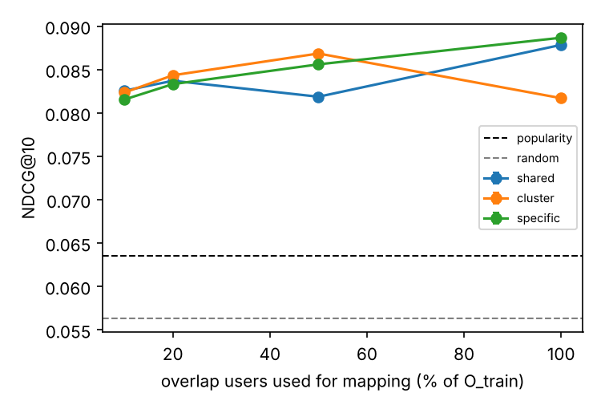

# Mapping Strategies for Cross-Domain Recommendation

Movies → Books cold-start recommendation on the Amazon Review Data (2018). We compare three
embedding-mapping strategies — **shared**, **cluster-based** and **user-specific** — as the number of
overlap users (users with ratings in both domains) used to train the mapping shrinks.

Course project, UVic CSC503 × SENG747 / SENG 474 (Fall 2026). Authors: Rishon Rajesh, Sahil Sanghvi,
Sam Sanjay Satish, Soorya Vasudevan (project lead).

## 1. Overview

1. Learn user/item embeddings in each domain by matrix factorization (mini-batch gradient descent).
2. Hold out 20% of the overlap users (**O_test**) and remove their book ratings *before any training*.
3. Draw overlap subsets of the remaining overlap users (10 / 20 / 50 / 100 %), identical for all strategies.
4. Train each mapping `g: R^k → R^k` from movie embeddings to book embeddings on each subset
   (3 strategies × 4 subsets = 12 trained mappings).
5. For each cold-start test user score every book with `g(f_m(u)) · v_b`, rank, and report NDCG@n.
   Popularity and random rankers are reported as sanity baselines.

The strategies are *simplified* variants inspired by EMCDR (shared), MacCDR (cluster) and PTUPCDR
(specific), trained with one common embedding-oriented loss so the comparison is controlled. They are not
reproductions of those papers (see the project report for the exact differences).

## 2. Illustrative sample

After `python quickstart.py` (synthetic data, ~30 s on a laptop CPU):



The quickstart prints one line per (strategy, overlap fraction) and writes the table and chart under
`evaluation/results/quickstart/`. A sample run (seed 0, `configs/quickstart.yaml`) gave the NDCG@10 values
below; `users` is the number of overlap users used to train the mapping.

| Strategy | 10% (110 users) | 20% (221) | 50% (553) | 100% (1107) |
|---|---|---|---|---|
| shared   | 0.0826 | 0.0837 | 0.0819 | 0.0878 |
| cluster  | 0.0823 | 0.0843 | 0.0868 | 0.0817 |
| specific | 0.0815 | 0.0833 | 0.0856 | 0.0887 |

Baselines (independent of the overlap fraction): popularity 0.0636, random 0.0564.

The data is synthetic, so these numbers only show that the pipeline runs end to end and that every mapping
beats the baselines. They do not compare the strategies on real data. Your exact values may differ slightly
on other hardware or PyTorch versions (this run used Python 3.13, PyTorch 2.15, CPU).

## 3. Prerequisites

- Python 3.10+ (tested with 3.13 and 3.14). The full Books file has ≈27 M ratings; parsing stores only integer ids,
  so it fits on a 16 GB laptop.
- About 8 GB of disk for the two data files (Books ≈7.1 GB, Movies and TV ≈0.8 GB).
- Packages: see `requirements.txt` (numpy, scipy, scikit-learn, torch, pyyaml, matplotlib, pytest).

## 4. Installation

```bash
git clone https://github.com/rishon-r/SENG474-Cross-Domain-Recommendation-System.git
cd SENG474-Cross-Domain-Recommendation-System
python3 -m venv .venv && source .venv/bin/activate      # Windows: .venv\Scripts\activate
pip install -r requirements.txt
# or: conda env create -f environment.yml && conda activate cdr-mapping
```

Download the public dataset (not stored in the repo):

```bash
bash scripts/download_data.sh        # curl -> data/raw/Movies_and_TV_5.json.gz, Books_5.json.gz (~8 GB; re-run to resume)
```

Source: <https://cseweb.ucsd.edu/~jmcauley/datasets/amazon_v2> ("Movies and TV" and "Books" 5-core files).
If a URL in the script is out of date, copy the current link from that page into `scripts/download_data.sh`.

## 5. Quick start

```bash
python quickstart.py                       # no download needed
python -m pytest -q                        # tests: no leakage, MF converges, NDCG value, determinism
```

Full run on the real data:

```bash
python -m src.main --config configs/default.yaml
```

For a quick debug pass, run `python -m src.main --config configs/debug.yaml`, or set `user_frac: 0.05` in any config. It keeps a fixed 5% of users, chosen by a hash of the
reviewer ID, so the same users are kept in both files and the overlap is preserved. Parsed data and embeddings are
cached under file names that include a hash of the settings, so changing `user_frac`, the split or the embedding
settings never reuses stale files; use `--force` to recompute anyway.

## 6. Results

Real-data results will be added here after the evaluation milestone. The quickstart uses a synthetic dataset
with planted structure, so its numbers only demonstrate that the pipeline works (mappings beat the popularity
and random baselines); they say nothing about the Amazon data.

Outputs of a run: `evaluation/results/results.csv` (every seed/strategy/fraction),
`results_summary.csv` (mean ± std over seeds) and `charts/ndcg_vs_overlap.png`.

## Reproducibility

Given the same data, code, config and seed, a run reproduces the same numbers (`tests/test_pipeline.py::test_same_seed_same_results`).
Seeds control the test split, subset sampling, embedding initialization and batch order, K-means and network
initialization (`src/cmn/seed.py`). Exact bit-for-bit equality across different hardware or PyTorch versions is not
guaranteed. Do **not** tune hyperparameters on O_test.

## Repository structure

```
README.md  LICENSE  requirements.txt  environment.yml  quickstart.py
configs/        default.yaml (real data), quickstart.yaml (synthetic)
scripts/        download_data.sh
data/raw/       downloaded .json.gz files          (git-ignored)
data/preprocessed/  parsed rating arrays           (git-ignored)
output/         embeddings and other artifacts     (git-ignored)
evaluation/ground_truth/  held-out O_test ratings  (git-ignored)
evaluation/results/       results.csv, summary, charts
evaluation/reports/       figures used in docs
src/
  main.py       pipeline entry point (Algorithm 2)
  cmn/          config, seeding, synthetic data generator
  data/         parsing + overlap/test split + subsets
  embeddings/   matrix factorization (Algorithm 1)
  mappings/     models.py (MLP, meta-network) and train.py (shared / cluster / specific)
  evaluation/   recommend.py (Eq. 4, Algorithm 3), metrics.py (NDCG@n)
  libs/         (reserved for customized third-party code)
tests/          pytest suite
```

Code ↔ paper: `embeddings/mf.py` = Algorithm 1; `main.py` = Algorithm 2; `mappings/train.py::fit` = `Fit`;
`evaluation/recommend.py` = Algorithm 3 / Eq. 4.

## AI use statement

This project is a Category D milestone (AI task completion, human evaluation). The code in this repository was partly
generated by an AI assistant (Claude, Anthropic) and was reviewed, run and evaluated by the team; see the
commit history and issues for the team's review and changes. All AI-created content is cited here as required.

## 7. Citation

- Chen, Zang, Li. 2026. *MacCDR: A Memory-Augmented Cluster-Level Preference Mapping Framework for Cross-Domain Cold-Start Recommendation.* BESC 2025, LNCS 16432, 193–207.
- Man, Shen, Jin, Cheng. 2017. *Cross-Domain Recommendation: An Embedding and Mapping Approach.* IJCAI-17, 2464–2470.
- Zhu et al. 2022. *Personalized Transfer of User Preferences for Cross-domain Recommendation.* WSDM '22, 1507–1515.
- Koren, Bell, Volinsky. 2009. *Matrix Factorization Techniques for Recommender Systems.* Computer 42(8), 30–37.
- Ni, Li, McAuley. 2019. *Justifying Recommendations using Distantly-Labeled Reviews and Fine-Grained Aspects.* EMNLP-IJCNLP, 188–197 (Amazon Review Data 2018).

## 8. License

MIT — see `LICENSE`.
